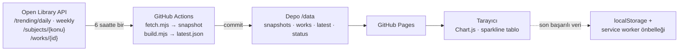

# Okuma Pusulası — Kitap eğilim panosu

**Koleksiyon karar desteği için kitap eğilim panosu.** Bir ilçe halk kütüphanesinin (kurgusal müşteri) kütüphanecisi için, Open Library trend verisinden 6 saatte bir kendiliğinden güncellenen, konu ve yayın yılına göre süzülebilen erişilebilir bir karar panosu.

- **Canlı ürün:** https://KULLANICI.github.io/kitap-egilim-panosu/
- **Vaka çalışması:** https://KULLANICI.github.io/kitap-egilim-panosu/vaka-calismasi.html
- **Demo videosu:** _(yayınlandığında eklenecek)_

> Öğrenci projesidir (MCBÜ · BVA 2245 Kullanıcı Arayüzü Tasarımı). Müşteri kurgusaldır; Open Library veya herhangi bir kütüphane ile resmî bağı yoktur.

## CV cümlesi

> Open Library trend verisini GitHub Actions ile 6 saatte bir çekip zaman serisi biriktiren, kütüphanecilerin hangi kitabın kalıcı eğilim olduğunu konu ve yayın yılına göre görebildiği erişilebilir bir karar panosu geliştirdim (Chart.js, PWA, Lighthouse mobil erişilebilirlik __).

_(Lighthouse puanı ölçüldükten sonra boşluk doldurulacak.)_

## Özellikler

| Gereksinim | Uygulama |
|---|---|
| Otomatik veri | `.github/workflows/veri-cek.yml` — cron `17 */6 * * *` + elle çalıştırma |
| Snapshot birikimi | `data/snapshots/YYYY-MM-DDTHH.json` (her çalıştırmada bir dosya) |
| Son güncelleme + kaynak | Üst şeritte her zaman görünür (İstanbul saati) |
| 3+ KPI | Listedeki kitap · En uzun süredir listede · Son 10 yıl yayın oranı · Yükselişte |
| Ana / ikincil grafik | Konulara göre günlük–haftalık liste (yatay çubuk, taralı desen) · Yayın dönemi dağılımı |
| İleri özellik | Konu + yayın yılı filtreli, satır içi **sparkline**'lı, erişilebilir **sıralanabilir tablo**; **listede kalınan gün** sütunu |
| Durumlar | İskelet (yükleniyor), boş sonuç, hata (hiç veri yok), son başarılı veriyle açılış uyarısı |
| Tasarım kısıtı | Sıcak palet, Literata serif gövde, **Yetişkin / Çocuk** görünüm modu |
| Erişilebilirlik | Klavye, görünür odak, ≥ 4.5:1 kontrast ([docs/kontrast.md](docs/kontrast.md)), grafik özetleri, tablo alternatifi, renk + ikon/desen |
| Bonus | PWA (manifest + service worker), TR/EN |

### Demo için test bağlantıları

| Bağlantı | Ne gösterir |
|---|---|
| `index.html?test=yavas` | Yanıt 2,5 sn gecikir → iskelet (yükleniyor) |
| `index.html?test=bos` | Sonuç döndürmeyen filtre → boş durum |
| `index.html?test=hata` | Veri adresi bozulur → son başarılı veriyle açılış + uyarı (bu cihazda hiç veri yoksa hata ekranı) |
| `index.html?mod=cocuk&lang=en` | Çocuk modu, İngilizce |

Ağ kapatıldığında (DevTools → Network → Offline) service worker son veriyi sunar ve pano uyarı bandı gösterir.

## Mimari



- **Hız sınırı:** İstekler arasında en az 1,1 sn; 429 yanıtında artan bekleme; eser ayrıntıları `works.json`'da önbelleklenir, her eser için yalnızca bir kez istek atılır. Tanımlayıcı `User-Agent` gönderilir.
- **Hata yolu:** Çekim başarısızsa `latest.json` değişmez, `status.json` `ok:false` olur, iş akışı kırmızı görünür; pano kullanıcıya “kaynak son denemede yanıt vermedi” uyarısı gösterir.
- **API anahtarı:** Open Library anahtar gerektirmez; depoda veya istemci kodunda gizli bilgi yoktur.

### Hesaplanan alanlar (`scripts/build.mjs`)

- `days`: kitabın günlük trend listesinde göründüğü **farklı takvim günü** sayısı (Europe/Istanbul).
- `series`: son 28 ölçümdeki günlük sıra (yoksa `null`) → sparkline.
- `status`: ~24 saat önceki ölçüme göre ≥ 3 sıra yukarı **yükseliyor**, ≥ 3 aşağı **düşüyor**, ilk kez görüldüyse **yeni**; ayrıca **yalnız haftalıkta**, **listeden çıktı**.
- `category`: 12 konu grubuna eşleme (`scripts/categories.mjs`); `child`: çocuk/gençlik etiketi.

## Veri kaynağı ve lisans

- Veri: [Open Library](https://openlibrary.org) — Internet Archive projesi; katalog verisi açık veridir ([lisans bilgisi](https://openlibrary.org/developers/licensing)). Yalnızca toplulaştırılmış sıralamalar gösterilir; kişisel veri ve kapak görseli kullanılmaz.
- Chart.js 4.6.1 — MIT ([vendor/chart.js-LICENSE.md](vendor/chart.js-LICENSE.md))
- Literata yazı tipi — SIL Open Font License 1.1 ([fonts/OFL-LICENSE.txt](fonts/OFL-LICENSE.txt))
- Proje kodu — MIT ([LICENSE](LICENSE))

## Kurulum

Gereken: Node.js 20+ (bağımlılık yok) ve herhangi bir statik sunucu.

```bash
git clone https://github.com/KULLANICI/kitap-egilim-panosu.git
cd kitap-egilim-panosu
node scripts/fetch.mjs     # Open Library'den bir snapshot al
node scripts/build.mjs     # data/latest.json üret
python3 -m http.server 8080   # http://localhost:8080
```

Gerçek API'ye erişmeden veri hattını denemek için:

```bash
node tests/mock-openlibrary.mjs &                       # sahte API :8787
OL_BASE=http://localhost:8787 GAP_MS=0 DATA_DIR=/tmp/olt node scripts/fetch.mjs
DATA_DIR=/tmp/olt node scripts/build.mjs
```

### GitHub'da yayın

1. Depo **Settings → Pages → Source: GitHub Actions**.
2. **Actions → “Veri çek (Open Library)” → Run workflow** (ilk snapshot + yayın).
3. Sonraki çekimler 6 saatte bir kendiliğinden çalışır.

## Klasör yapısı

```
.github/workflows/  veri-cek.yml (cron), yayinla.yml (Pages)
scripts/            fetch.mjs, build.mjs, categories.mjs
data/               snapshots/, works.json, latest.json, status.json
js/ css/ fonts/     arayüz
vendor/             chart.umd.min.js
tests/              sahte Open Library sunucusu
docs/               kontrast ölçümleri, kullanıcı testi, demo metni, ekran görüntüleri
vaka-calismasi.html portfolyo vaka çalışması
```

## Yapay zekâ kullanım beyanı

Bu projede **Claude (Anthropic)** kullandım.

| Ne için | Nasıl kullandım | Benim katkım / değişikliklerim |
|---|---|---|
| Veri hattı (`scripts/`, iş akışları) | Betiklerin ve Actions iş akışının ilk sürümünü ürettirdim | _(doldurulacak: örn. konu gruplarını kütüphane bölümlerine göre düzenledim, çekim sıklığını belirledim…)_ |
| Arayüz kodu (`index.html`, `css/`, `js/`) | Bileşenlerin ilk sürümü, erişilebilirlik kontrolleri (axe) | _(doldurulacak)_ |
| Vaka çalışması ve README metinleri | Taslak metin | _(doldurulacak)_ |
| Test | Sahte API sunucusu ile veri hattı testi, ekran görüntüleri | Kullanıcı testlerini kendim yürüttüm |

Tüm kodu okudum ve demoda açıklayabilirim; kullanıcı testi verileri gerçek katılımcılardan toplanmıştır.
